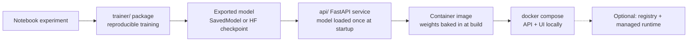

# From notebook to service

This explains how the research notebook became the local app, and what it would take to go further.

## 1. Separate training from serving
The notebook mixes data loading, training, evaluation and deployment calls. The `bert-sentiment-classifier/trainer/` package already pulls training out into a script. Serving lives in `api/`, which only loads a finished model and runs inference.

## 2. Pick a model artifact
- **Today:** a public Hugging Face checkpoint (`MODEL_NAME`) that's downloaded during `docker build`.
- **Your own model:** export the notebook's fine-tuned model (`model.save(...)`), or retrain with `transformers` and `save_pretrained()`. Then point `MODEL_NAME` at a local path or a private Hub repo. If you keep the TF-Hub SavedModel, swap `api/app/model.py` to load it with `tf.saved_model.load` and keep the same `predict()` contract.
- Never commit weights. Use build args, a model registry, or object storage.

## 3. Wrap it in an API with a stable contract
`POST /predict` takes `{"texts": [...]}` (1–64 items) and returns a label, the positive probability and a confidence score for each text. `GET /health` reports which model is loaded. The model loads once per process, and the input is truncated to the model's maximum length.

## 4. Test without the model
`tests/` stubs the classifier, so CI checks the API contract quickly. The image build in CI confirms the weights can still be fetched and that the dependencies resolve.

## 5. Containerize
`api/Dockerfile` installs CPU-only PyTorch, bakes the weights into the image, and adds a healthcheck. The UI waits for the API to report healthy before it starts.

## 6. Next steps (not needed for local use)
- Batch inference and request size limits tuned to the hardware.
- Model versioning (MLflow or the Vertex Model Registry) plus an evaluation gate on a held-out IMDB split.
- GPU or ONNX/quantized builds if latency matters.
- Deployment to Cloud Run or a Vertex endpoint. The original Vertex pipeline in this repo already covers the managed path.
