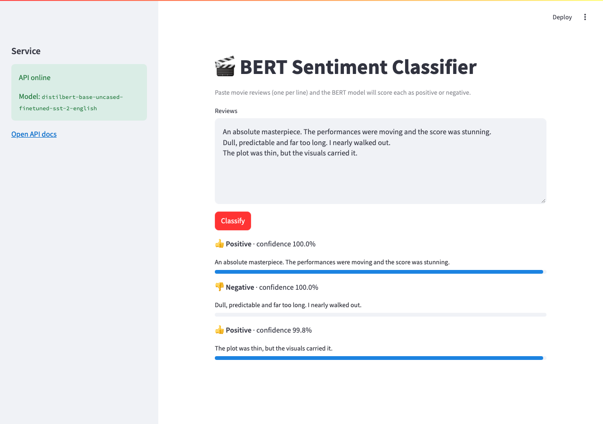
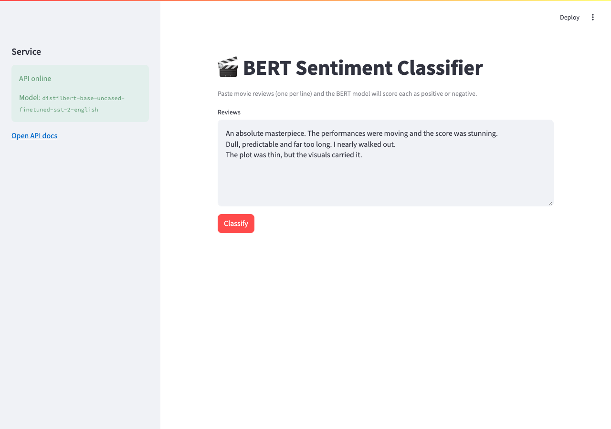
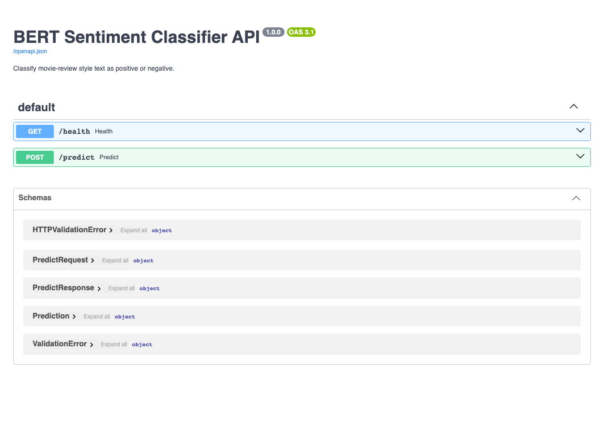
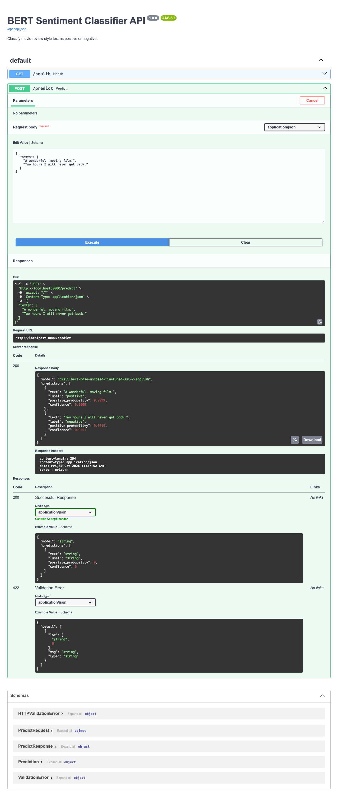
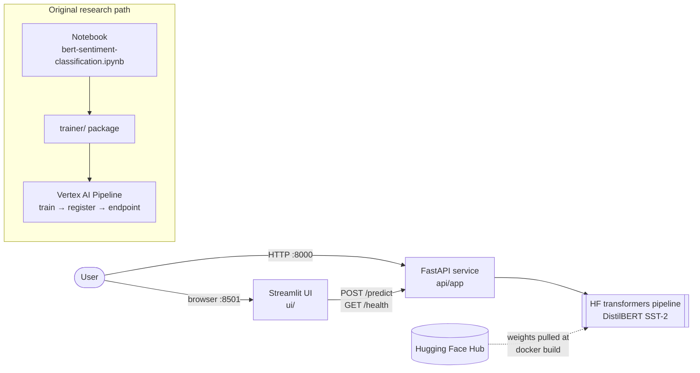

# 🎬 BERT Sentiment Classifier

**Score movie reviews as positive or negative with a BERT model, running on your laptop with a single command.**

This repo started as a Vertex AI notebook that fine-tuned a TF-Hub BERT model and deployed it to a managed endpoint. It now also ships a **local app**: a FastAPI inference service and a Streamlit UI, both started with `docker compose up`.



---

## Quick start

```bash
cp .env.example .env
docker compose up --build
```

| Service | URL |
|---|---|
| Streamlit UI | http://localhost:8501 |
| FastAPI (Swagger docs) | http://localhost:8000/docs |

The first build downloads the model weights (~260 MB) into the image. Weights are never committed to git.

## The app

### 1. Paste reviews
One review per line. The sidebar shows the API's health and which model is loaded.



### 2. Get a verdict per review
Each review gets a label, a confidence score, and a bar showing the positive probability.


### 3. Or call the API directly

```bash
curl -X POST localhost:8000/predict -H 'content-type: application/json' \
  -d '{"texts": ["A wonderful, moving film.", "Two hours I will never get back."]}'
```

```json
{"model":"distilbert-base-uncased-finetuned-sst-2-english","predictions":[
  {"text":"A wonderful, moving film.","label":"positive","positive_probability":0.9999,"confidence":0.9999},
  {"text":"Two hours I will never get back.","label":"negative","positive_probability":0.0249,"confidence":0.9751}]}
```




## Architecture



## About the model

The notebook's fine-tuned TF-Hub BERT weights lived in a GCS bucket and were never published. So the local app uses `distilbert-base-uncased-finetuned-sst-2-english`, a public BERT-family model fine-tuned for the same binary sentiment task. To use a different Hugging Face model, set `MODEL_NAME` in `.env` and rebuild. See [PRODUCTIONIZING.md](PRODUCTIONIZING.md) for how to serve your own notebook-trained model instead.

## Repo layout

| Path | What it is |
|---|---|
| `api/` | FastAPI inference service and its Dockerfile |
| `ui/` | Streamlit front end and its Dockerfile |
| `tests/` | API tests (the model is stubbed, so they run in under a second) |
| `scripts/screenshots.py` | Regenerates `docs/screenshots/` from the running stack |
| `bert-sentiment-classification.ipynb` | Original training notebook |
| `bert-sentiment-classifier/` | Original Vertex AI trainer package and Cloud Build config |
| `docs/VERTEX_AI_WALKTHROUGH.md` | The original GCP walkthrough |

## Development

```bash
pip install -r requirements-dev.txt
pytest -q
```

CI (GitHub Actions) runs the tests and then `docker compose build` on every PR.
